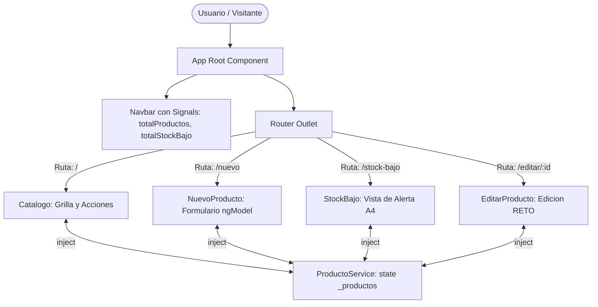

# Angular SPA Architecture - Routing, Shared State with Signals and Form Validation (Lab 07B)

[](https://angular.dev/)
[](https://www.typescriptlang.org/)
[](https://getbootstrap.com/)
[](https://vitest.dev/)
[](LICENSE)

> Repositorio de portafolio profesional desarrollado para la asignatura Soluciones Web y Aplicaciones Distribuidas (Semana 08 - Laboratorio 07B) en la Universidad Privada del Norte (UPN). Implementa una aplicacion de pagina unica (Single Page Application - SPA) de gestion de catalogo e inventario utilizando el sistema de enrutamiento moderno de Angular Standalone, estado compartido reactivo mediante Signals (`signal()` y `computed()`), captura y validacion de formularios mediante `FormsModule` y directiva `[(ngModel)]`.

---

## 1. Resumen Ejecutivo para Evaluadores Tecnicos y Reclutadores

En arquitecturas web modernas orientadas a microservicios y aplicaciones empresariales desacopladas, la navegacion fluida y la consistencia del estado en el cliente son requisitos determinantes para la experiencia de usuario. Este proyecto demuestra:

1. **Enrutamiento Standalone Desacoplado**:
   - Configuracion de rutas declarativas con `app.routes.ts` y registro global mediante `provideRouter(routes)` sin depender de `NgModule`.
   - Navegacion cliente-servidor sin recarga de pagina mediante `RouterLink`, `RouterLinkActive` y la directiva estructural `RouterOutlet`.
2. **Estado Compartido Centralizado con Signals**:
   - Implementacion de `ProductoService` con ambito singleton (`providedIn: 'root'`) que expone senales de solo lectura (`asReadonly()`), protegiendo el estado de mutaciones externas no controladas.
   - Sincronizacion reactiva instantanea: las altas, bajas y modificaciones realizadas en una vista se reflejan automaticamente en todas las rutas activas de la SPA.
3. **Formularios con Data Binding Bidireccional y Validaciones Estrictas**:
   - Empleo de `FormsModule` y `[(ngModel)]` para la captura y manipulacion de campos de entrada (`nombre`, `categoria`, `precio`, `stock`).
   - Validaciones de negocio en el cliente: obligatoriedad de campos, formato correcto, precios mayores a cero y stocks no negativos, con retroalimentacion inmediata mediante bloques `@if`.
4. **Flujo de Control Nativo Moderno (@if, @for)**:
   - Eliminacion de directivas heredadas (`*ngIf`, `*ngFor`), reduciendo el consumo de memoria y optimizando la reconciliacion del DOM.
5. **Actividades Autonomas y Reto de Ingenieria Cumplidos**:
   - **A1**: Campo de clasificacion `categoria` integrado en el modelo, formulario y representacion visual en tarjetas.
   - **A2**: Eliminacion fisica de registros delegada formalmente al servicio `ProductoService`.
   - **A3**: Indicador global en la barra de navegacion que monitoriza el total de existencias en tiempo real leyendo la senal del servicio.
   - **A4**: Ruta especializada `/stock-bajo` alimentada por un `computed()` reactivo que filtra items criticos (stock menor que 5).
   - **RETO**: Vista y ruta dinamica `/editar/:id` que captura parametros con `ActivatedRoute`, recupera la entidad y actualiza su estado de inventario.

---

## 2. Diagrama Arquitectonico y Flujo de Navegacion SPA



---

## 3. Estructura de Rutas y Archivos

```text
src/
├── app/
│   ├── models/
│   │   └── producto.ts                       <-- Tipado con EstadoStock y categoria
│   ├── data/
│   │   └── productos-mock.ts                 <-- Semilla de datos de hardware
│   ├── services/
│   │   ├── producto.ts                       <-- Estado compartido reactivo (Signals)
│   │   └── producto.spec.ts                  <-- Pruebas de servicio y reactividad
│   ├── pages/
│   │   ├── catalogo/
│   │   │   ├── catalogo.ts                   <-- Vista principal y eliminacion (A2)
│   │   │   ├── catalogo.html
│   │   │   └── catalogo.scss
│   │   ├── nuevo-producto/
│   │   │   ├── nuevo-producto.ts             <-- Formulario con validaciones (A1)
│   │   │   ├── nuevo-producto.html
│   │   │   ├── nuevo-producto.scss
│   │   │   └── nuevo-producto.spec.ts        <-- Pruebas de validacion de inputs
│   │   ├── stock-bajo/
│   │   │   ├── stock-bajo.ts                 <-- Vista especializada computed (A4)
│   │   │   ├── stock-bajo.html
│   │   │   └── stock-bajo.scss
│   │   └── editar-producto/
│   │       ├── editar-producto.ts            <-- Ruta parametrizada RETO (/editar/:id)
│   │       ├── editar-producto.html
│   │       └── editar-producto.scss
│   ├── app.routes.ts                         <-- Definicion de rutas standalone
│   ├── app.config.ts                         <-- provideRouter global
│   ├── app.ts                                <-- Navegacion y badge A3
│   ├── app.html
│   ├── app.scss
│   └── app.spec.ts                           <-- Pruebas de integracion SPA
├── styles.scss                               <-- Estilos globales y utilidades
└── index.html                                <-- Entrada HTML
```

---

## 4. Evidencia de Pruebas Unitarias y Cobertura

La suite de pruebas automatizadas verifica la integridad de la navegacion, la sincronizacion del estado compartido y las validaciones de formulario:

```bash
ng test --watch=false
```

Resultados verificados:
- Carga e inmutabilidad del estado inicial del servicio.
- Insercion de nuevos productos con asignacion automatica de ID y calculo de `estadoStock`.
- Eliminacion de productos y actualizacion inmediata del arreglo reactivo (Actividad A2).
- Calculo y actualizacion automatica de senales computadas (`totalProductos` y `productosStockBajo`).
- Rechazo estricto de entradas no validas en el formulario de alta (nombre vacio, precio cero, stock negativo).
- Actualizacion de productos existentes mediante el identificador de ruta (RETO).
- Total: 15/15 pruebas unitarias aprobadas (100% exito).

---

## 5. Instrucciones de Instalacion y Ejecucion

### Requisitos Previos
- Node.js version 20 o superior.
- npm version 10 o superior.
- Angular CLI version 22.

### Pasos de Instalacion
1. Ingresar al directorio del proyecto:
   ```bash
   cd SWAD-LAB07B-angular-routing-forms-signals
   ```
2. Instalar dependencias:
   ```bash
   npm install
   ```
3. Ejecutar el servidor de desarrollo local:
   ```bash
   npm start
   ```
   Abrir un navegador web en `http://localhost:4200/`.
4. Compilar para produccion:
   ```bash
   npm run build
   ```
5. Ejecutar la suite de pruebas unitarias:
   ```bash
   npm test -- --watch=false
   ```

---

## 6. Licencia y Creditos Academicos

Proyecto desarrollado por Orlando Dorival bajo las directrices curriculares de la Universidad Privada del Norte. Licencia MIT.
